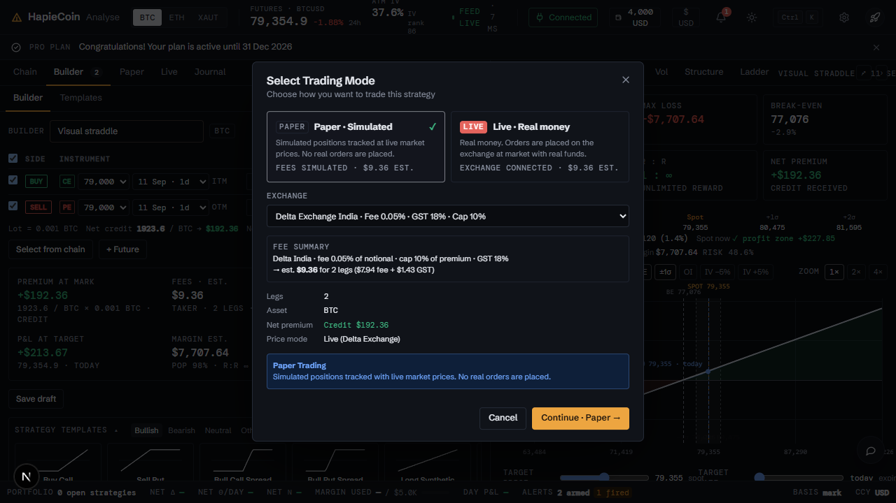
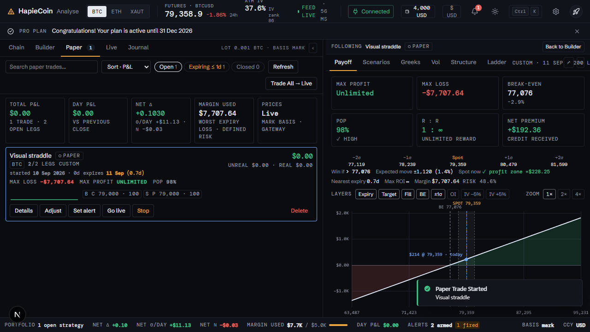
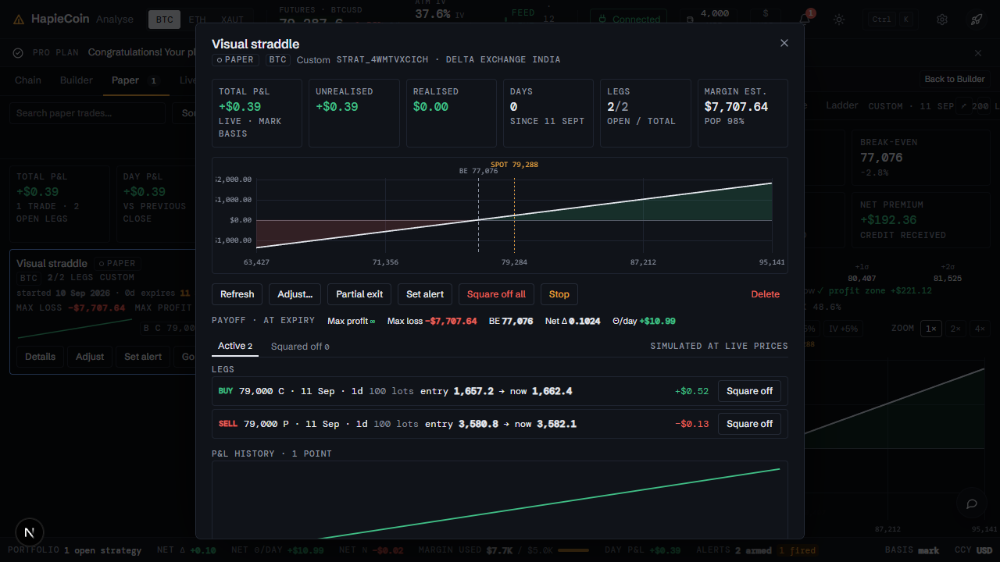
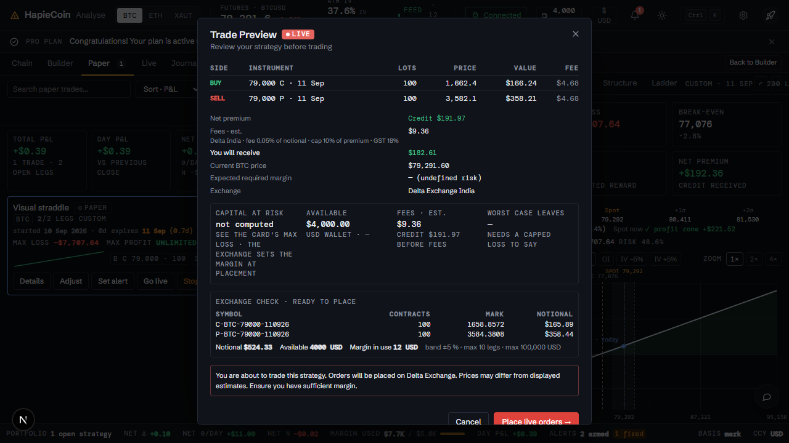
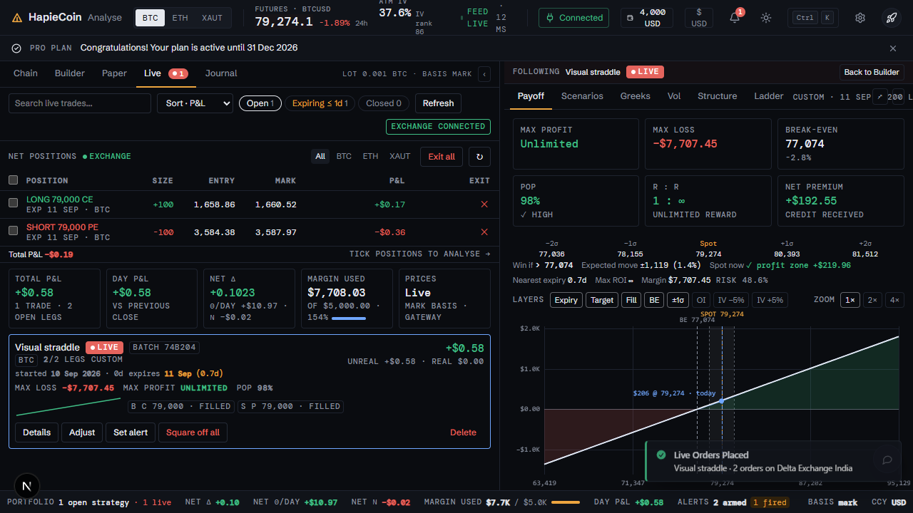

# Paper trading, live trading, rules and accounts

Part of the [HapieCoin feature guide](README.md). 152 traced features on 35 screens; 152 built and tested, 0 still mock-only (listed in the backlog).

## What it does

A strategy is traded from the Builder in one flow: choose Paper or Live, review the preview (legs, prices, capital block, overlap with other open strategies, the exchange's own check for live), optionally add a Protect rule, and place. Paper trades fill at mark and track P&L from the live feed. Live trades go to Delta Exchange through the stored API key: the preview shows the venue check and wallet, the typed word **LIVE** is required, and a Mindful pause applies when you are down on the day.

Cards on the Paper and Live tabs show P&L, greeks, days to expiry, lifecycle chips, order chips (filled, resting, cancelled) and actions: Details, Adjust, Square off, Partial exit, Set alert, Rules, Go live, Re-enter. Rules (strategy stop / target in money or %, leg stop, spot level, time) run on the server against the feed and exit for you. Expiry settlement closes legs at settlement with a reason. Positions are reconciled against the exchange with a drift check. Several labelled keys per exchange map to accounts; each strategy belongs to one.

## Try it

1. Builder → **Paper trade** → Continue → Trade now → confirm the name → skip or set a Protect rule. The card appears on **Paper** with live P&L.
2. Card → **Details**: legs, orders, P&L history. Card → **Square off** or **Partial exit**.
3. Card → **Rules**: a strategy stop at −$50 and a target at +$100; watch the badges.
4. Card → **Go live** (needs a Delta key in Settings): the preview shows the venue check and the wallet; type LIVE; place. On the **Live** tab the order chips show the fill.
5. Paper tab → **Trade All → Live** previews the batch as one: every strategy's check and the wallet against the total.
6. A resting limit entry shows a **Resting** chip: cancel it or re-price it from the card.

## Screens

*Select trading mode*

*Paper trades*

*Strategy details*

*Live preview with the exchange check*

*Live trades with order chips*

## Every feature, in detail

Each row is one traced feature from the build spec: the id, what it is, how it behaves (the acceptance rule the tests check), and how it is tested. Status "mock-only" means the screen exists but the data feed behind it is not connected yet.

### Trading · Autopilot · `/desk`

| ID | Feature | How it behaves | Status | Tested by |
|---|---|---|---|---|
| HC-TR-216 | A trader switches Autopilot on and chooses the playbooks it may enter on paper, each with how a winner is taken off | GET / PUT /v1/autopilot behind the session: enabled, and a list of playbooks each with exit trail or target; the control, an unknown playbook and a repeat are refused; settings in autopilot_settings (migration 0028); paper only | built | unit (api + schema) |
| HC-TR-217 | After every market snapshot the server opens a paper trade for each switched-on playbook whose plan enters on that snapshot's prices, with its exits armed | runAutopilot in the snapshotter's after-hook (leader only): the recorded history with the newest snapshot as today, through the backtest's entryFor; the entry at that snapshot's marks; one open Autopilot trade per trader, playbook, venue and asset; a 15-minute wait after a trade ends; the target at 10 % of the maximum profit plus entry and exit fees (closing there, or trailing with a 10 % give-back), the playbook's stop and time exit, all as ordinary rules; no entry when the trader has no plan, the snapshot is older than twelve minutes, a leg has no price, the fees eat the target, or a futures leg is involved; a trade closed by hand is closed out and starts the wait; the levels use the trader's own lot size; an Autopilot trade cannot go live (place and batch refuse it); Autopilot trades do not use the monthly paper allowance | built | unit (api) |
| HC-TR-218 | Autopilot keeps a log: every entry with its figures, every reason it did not enter, and a note when a better entry appears while a trade is open | autopilot_runs per trader: entered (spot, days to expiry, premium, maximum profit and loss, fees, capital, target, stop, legs), skipped (the reason, written once per change of reason), noted (the structure prices at least 10 % better than the open trade's entry, at most once per 15 minutes); the newest 200 lines come with GET /v1/autopilot | built | unit (api + schema) |
| HC-TR-219 | The Autopilot screen: the master switch, a summary, and one card per strategy with its switch, how a winner is taken off, its record and what it is doing now | /autopilot behind the sign-in and plan check; the switch and every card change save through PUT /v1/autopilot; the summary shows open trades, the capital they tie up, today's result and strategies on; a card shows the playbook's record per coin and, per coin, the open trade's P&L or the newest reason it did not enter; the log lists the newest lines; a failed load offers a retry | built | unit (web) |
| HC-TR-220 | The trades Autopilot holds, each with a health reading, its exit levels, Exit now and Open on the Desk; Stop everything switches it off and closes them all | only strategies Autopilot opened and still holds; health in three steps from the P&L and the stop distance (on track, losing, close to its stop at three quarters used), shown only while every open leg has a live price; the target or trailing level and the stop from the rules armed at entry; Exit now through the Paper list's stop dialog, which offers no draft for an Autopilot trade (the API refuses one); Open on the Desk follows the trade in the pane; Stop everything, after a confirmation and with live prices, saves enabled off, reads again what Autopilot holds and squares each trade off, never the trader's own; a trade with no live price or one the server refuses is left open and named; the list is re-read every minute | built | unit (web) |
| HC-TR-221 | Autopilot takes a playbook's entry on other strikes as a new trade beside the open one: one trade per structure, five at most, one entry per 15 minutes | a trade's structure is every leg's side, kind, strike and expiry; the structure a trade holds is never entered twice and a better price for it is a note on that trade; other strikes or another expiry go through the same entry checks and open a second trade; a sixth is a logged reason; the wait runs from the key's newest entry or close; the structure the trade was entered on is stored on the strategy, is part of the unique index and is what the engine compares against, so a leg added by hand does not make it another trade | built | integration (api) |
| HC-TR-222 | The Autopilot screen adds a strategy's trades on one coin up on its card and shows each trade's strikes and expiry | a card's line for a coin says In a trade or In N trades with their P&L together and the worst health among them, or waiting for prices while any leg has none; each row under Running now carries the strikes and the expiry the trade sits on; the introduction states the one-trade-at-a-time rule (ADR-112) and the 15-minute wait | built | unit (web) |
| HC-TR-223 | GET /v1/autopilot/results: what the paper trades Autopilot opened came to, by playbook, asset, exit style and days to expiry | every logged entry joined to its strategy; an open trade is counted, a closed one adds its realised P&L less the fees estimated at entry; a win is a closed trade above zero after fees; grouped by playbook, asset and exit style (best, worst, mean time held, close reasons) and by four days-to-expiry bands, with a total and the newest 100 closed trades; money summed in cents; an Autopilot trade cannot be deleted (409), and one squared off by hand counts as closed | built | integration (api) |
| HC-TR-224 | The Autopilot screen shows its results: totals, trail against target, a table per strategy and exit style, a table by days to expiry, and the closed trades | under the strategies: closed and still open, won with the win rate, net after fees with the gross and the fees, the trail and the target exit side by side; one row per strategy, coin and exit style; one row per days-to-expiry band; the newest 25 closed trades with strikes, expiry and how they ended; an empty state before any trade, a note while none has closed, a retry when the read fails; re-read each minute | built | unit (web) |
| HC-TR-225 | Autopilot enters four evening strangles by the clock, on the nearest expiry, with their own exits, and holds one trade per strategy and coin at a time | four playbooks outside the recorded list, BTC, 100 lots: sold three (or five) strikes out with wings eight (or ten) out and held to settlement, or sold three out with each sold option bought back at two (or three) times its price; entered once in the hour from 16:00 UTC (21:30 IST) on Delta India, on the first expiry at least half a day and at most a day and a half out, when the premium exceeds both fees; a leg stop rule per sold option, no Autopilot profit level; saved with the exit style own; outside the window, holding a trade and already entered are logged reasons; AUTOPILOT_MAX_OPEN is 1 | built | integration (api) |
| HC-TR-226 | The Autopilot screen shows the evening strategies: when each enters, how it exits, the backtest behind it, and the stop on each sold option of a running trade | a card of a strategy entered by the clock states its window, its exit (held to settlement behind its wings, or each sold option bought back at a multiple of its price) and the backtest figure with its sample, marked Backtest only; it has no exit style to choose and is saved with its own exits; a running evening strangle shows its profit level when it has one (the take-half version) or that it is held to settlement, and the stop on each sold option; capital in use reads not bounded while a strangle with no wings is open; the results count the own style beside trail and target | built | unit (web) |
| HC-TR-227 | A fifth evening strangle takes its profit at half the premium collected, beside the stop-at-double one it is otherwise identical to | evening-strangle-take-half: sold three strikes out in the evening window, each sold option bought back at twice its price, and a target on the whole trade at half the premium (an ordinary target rule, no trail); the card states both exits; the results compare it with the stop-at-double version under the own style | built | integration (api) |
| HC-TR-228 | A sixth evening strangle trails the other side after a stop, beside the stop-at-double one that keeps it | evening-strangle-trail-rest: sold three strikes out in the evening window, each sold option bought back at twice its price, the stop set to this leg then trail the rest with a give-back of 50 %, so after one stop the other option is closed when its profit falls back by half of its best; the card says so; the results compare it with the stop-at-double version | built | integration (api) |
| HC-TR-229 | Autopilot enters ten weekly strangles: five exits, each on a Friday for next Friday's expiry and on a Tuesday for that week's Friday expiry | WEEKLY_PLAYBOOKS, BTC on Delta India, 100 lots, sold at the listed strikes nearest 3 % of the spot away (a template leg's pct), with wings 7 % away held to settlement, a stop at double, a stop at triple, the stop at double with a take at half the premium, or the stop at double then a trail on the rest; the clock has a day of the week and the expiry is bounded on both sides, so a daily or a later weekly is never taken; another day and a missing Friday expiry are logged reasons | built | integration (api) |
| HC-TR-230 | The Autopilot screen groups its strategies in three families and a weekly card says its day, its expiry and its exit | the cards sit under Longer-dated strategies, Evening strangles (daily expiry) and Weekly strangles (Friday expiry), each with a line on when it enters; a weekly card reads Entered each Friday or each Tuesday with its expiry, then its exits and the backtest figure | built | unit (web) |
| HC-TR-231 | A playbook has a cadence (trend, daily, weekly, monthly) and, when entered by the clock, its backtest as figures | playbookCadence follows from the clock (none: trend; a day of the week: weekly; a flag: monthly; else daily); playbookBacktest gives the mean per trade, the share won, the worst and the sample of a clock playbook, the same figures its evidence sentence quotes | built | unit (pricing) |
| HC-TR-232 | The Autopilot screen lists its strategies as rows and is narrowed by expiry and by coin | a bar with the expiry families and the coins narrows the strategies, the running trades, the log and the results together while the summary stays everything; a strategy is one row with its switch, when it enters, how it gets out, its backtest in figures, its paper result so far and what it is doing now per coin, with the full description under What it does; the results follow the selection without the days-to-expiry table; the header tabs scroll inside the header on a phone | built | unit (web) |
| HC-TR-233 | Autopilot sells strangles by premium, and enters three monthly strangles once per expiry with a stop and a take at half the premium | a template leg may name a premium: the listed out-of-the-money strike priced nearest it; an evening strangle at 100 a side and a Friday weekly one at 200 a side, each stopped at three times and closed at half the premium; ten monthly strangles on month-end expiries only (1,000 a side and 8 % away 60 to 75 days out; one month out, 12 % away under every exit of the other sets, with wings held, and with wings and a stop, and 8 % away with wings, a stop and the take), entered on the first evening the expiry is in range and never again for that expiry; no expiry in range and an expiry already traded are logged reasons; the screen lists them under Monthly | built | integration (api) |
| HC-TR-234 | The Autopilot settings hold every playbook the catalogue offers | the settings accept up to AUTOPILOT_MAX_STRATEGIES (500) playbooks, each at most once; the limit was 32 and the 33rd playbook switched on made the saved settings unreadable by the screen | built | unit (schema) |
| HC-TR-235 | Autopilot strangles on ETH and XAUT, each from that coin's own backtest | twenty playbooks that trade one coin each: six ETH and four XAUT evening strangles, five ETH weekly (four entered on a Friday, one on a Tuesday) and five ETH monthly ones on month-end expiries; strikes are the listed ones a percentage of that coin's spot away and the size is that coin's lot; Autopilot looks at XAUT as well as BTC and ETH; XAUT settles at 16:00 UTC, so its evening entry is the hour after one expiry for the next, with no entry on a Saturday evening; XAUT has no weekly or monthly playbook; the screen lists the rows under the coin filter | built | integration (api) |
| HC-TR-239 | Autopilot strategies with a profit ladder | a clock playbook may carry a ladder; Autopilot arms a step at each level, each an equal part of what is left, beside the stop on each sold option; three paper playbooks use 25 / 50 / 75 with a stop at triple: BTC daily, ETH daily and the BTC Friday weekly, beside the existing ones | built | integration (api) |
| HC-TR-241 | Ten Autopilot paper strategies from the strategy lab | a clock playbook may carry a profit lock, an exit hour or a trail from its take level; ten playbooks beside the existing ones: the lock on BTC daily and the BTC Friday weekly, out by 1:30 AM IST on BTC and ETH, half then trail on BTC and ETH, strikes 0.5 % away on BTC and ETH, ETH with wings at 3 % and no stop, and a BTC entry two hours before settlement whose card says the evidence is weak | built | integration (api) |
| HC-TR-242 | Autopilot strategies that sell only the side behind a 24-hour move | a clock playbook may carry a look-back and a threshold; at entry the spot is compared with the stored spot of 24 hours earlier (the nearest snapshot within 30 minutes): up more than 1 % only the put is sold, down more than 1 % only the call, otherwise both; with no earlier spot the evening is skipped and the log says why; two paper playbooks, BTC and ETH daily, strikes 1 % away with a stop at triple on each sold option | built | integration (api) |
| HC-TR-243 | The Autopilot log says the move an entry was judged on and the side it sold | an entry of a one-side strategy records the spot's move over 24 hours and the side kept; its log line reads "BTC up 1.56 % over 24 hours: the put only", or "both sides" after a flat day | built | component (web) |
| HC-TR-246 | An Autopilot strategy that buys a cheap option back | a clock playbook may carry a buy-back price; Autopilot arms one buy-back beside the stop on each sold option; one paper playbook, the BTC evening strangle 1 % away with a stop at triple and a buy-back at 5 dollars, whose card says it is protection and not income | built | integration (api) |
| HC-TR-248 | An Autopilot strategy that buys each option back at 20 % of its price | a clock playbook may carry a buy-back share; Autopilot arms each sold option's buy-back at that share of its own price; one paper playbook, the BTC evening strangle 1 % away with a stop at triple and a buy-back at a fifth of the price sold at, whose card says it is one good row among poor ones | built | integration (api) |
| HC-TR-249 | An Autopilot weekly strategy that closes the whole trade at 90 % of the premium | one paper playbook, the BTC Friday weekly strangle 3 % away with a stop at triple on each option, closes everything once the trade is up by 90 % of the premium collected; it uses the existing take-profit of a clock playbook (a share of the premium, armed as a target), with no new rule | built | integration (api) |
| HC-TR-258 | Autopilot daily strategies that close the whole trade at 90 % of the premium, or trail it from there | four paper playbooks, on BTC and on ETH: the evening strangle 1 % away with a stop at triple on each option, either closed once the trade is up by 90 % of the premium collected, or from that level trailed and closed when the profit gives back 5 % of its best; both use the existing take-profit of a clock playbook (a share of the premium armed as a target, which trails when it carries a give-back), with no new rule; each card says the study could not tell closing, trailing and holding apart | built | unit (pricing), integration (api), unit (web) |
| HC-TR-259 | An Autopilot strategy with the profit lock and the buy-back at 5 dollars on the same trade | one paper playbook, the BTC evening strangle 1 % away: a stop at triple and a buy-back at 5 dollars on each sold option, and on the whole trade a floor at a quarter of the premium once the profit has reached half; what a buy-back has banked counts toward the lock, which is judged on the realised and the open profit together; both exits are the existing ones, armed from the playbook's own fields, with no new rule; its card says it earned less than the lock alone in the study | built | unit (pricing), integration (api), unit (web) |
| HC-TR-261 | Autopilot daily strategies that trail the profit from 15 % of the premium | two paper playbooks, on BTC and ETH: the evening strangle 1 % away with a stop at triple on each option; once the trade is up by 15 % of the premium collected it is trailed and closed when the profit gives back 30 % of its best; the existing trailing take-profit of a clock playbook, with no new rule; each card says what the early exit costs against holding | built | unit (pricing), integration (api), unit (web) |
| HC-TR-262 | An Autopilot Gold strategy that trails the profit from 15 % of the premium | one paper playbook: the Gold evening strangle 1 % away at Gold's own entry, with its stop at double on each option; once the trade is up by 15 % of the premium collected it is trailed and closed when the profit gives back 20 % of its best; the existing trailing take-profit, with no new rule; its card says it costs a little income against holding and that the amounts are cents | built | unit (pricing), integration (api), unit (web) |
| HC-TR-263 | Autopilot weekly strategies that hold the Friday strangle for its first day only | two paper playbooks, on BTC (3 % away) and ETH (4 % away): the Friday weekly strangle of that coin with a stop at triple on each option, closed whole on Saturday at 5:30 PM IST, about 20 hours after the entry, whatever the profit; the existing timed exit of a clock playbook, with no new rule; the card says the exit is the next day's and gives the study's cautions (one of the best rows of 108, its neighbours fall away fast, fills at the mark); a running trade's row says when it will be closed in place of held to settlement | built | unit (pricing), integration (api), unit (web) |

### Trading · Protect dialog / cards · Details · `/desk`

| ID | Feature | How it behaves | Status | Tested by |
|---|---|---|---|---|
| HC-TR-211 | Protect dialog: Trail instead of exiting at the target, with the give-back and two worked exit levels; the card shows the best and the exit level once trailing; the fired chip says the target trailed | The Target box carries one more line, off by default: a checkbox, the unit (the trader's currency or %), the give-back and a sentence with the exit level at the target and at twice the target; a give-back at or above the target, or a percentage of 100 or more, disables Arm with the reason; with a trail already running the sentence gives the best so far and the exit the save produces (refused when the P&L is already under it), says when a higher target starts the trail over, and says the trail starts on arming when the P&L is already past the target; the box hint reads start trailing when P&L reaches; ruleText gives target at +X, then trail Y before the target and trailing: best +X, exits at +Y after it; firedLabel gives target hit · trailed from +X; Details lists the same words | built | unit (web) |
| HC-TR-213 | Protect dialog: a leg stop's What to exit offers "exit this leg, then trail the rest" with a give-back (10 % by default, or money) and a worked exit level; a running trail shows on the card and as its own box | The leg stop's What to exit select has a third option, disabled when no other leg is held; choosing it shows the give-back (% prefilled with 10, or the trader's currency) and a sentence with where the other legs stand now and where they would exit, or that a percentage waits while they are under water; an empty give-back or 100 % disables Arm with the reason; the card line reads "..., then trail the rest by 10 %"; the two older options send the body they always sent (no trail key); a running trail reads "trailing the rest: best ..., exits at ..." on the card and Details and has a box in the dialog where the give-back can be changed (the box says the trail then starts again from where the rest stands) or the trail removed by unticking, and which arrives ticked when a trail starts while the dialog is open; the fired chip reads "trail on the rest fired" | built | unit (web) |
| HC-TR-236 | A profit step closes part of a paper trade and keeps the rest | a rule of kind step fires when the lots still open are up by its level (their gain over the premium they were opened for) and closes its share of every open leg in whole lots, never none and never the last lot; a ladder is up to four steps and a last part with no rule; steps exclude a target, do not disarm the other rules, are judged lowest level first, and are refused on a live trade | built | integration (api) |
| HC-TR-237 | Take profit in steps in the Protect dialog | a box under the Target with presets (Early 10 / 25 / 40 / 55, Standard 25 / 50 / 75, Late 50 / 75, each with the last part held) and custom rows of a level and whole lots; it shows what each step banks, turns the target off when ticked and the other way round, and refuses lots that do not add up, levels that do not rise, a level already reached, and a live trade | built | component (web) |
| HC-TR-238 | The card counts the profit steps taken | the rules line of a trade reads "profit steps 1 of 4 taken, next at 50 %" beside its other armed rules, and "the rest held" once the last step has fired | built | unit (web) |
| HC-TR-240 | A profit lock holds a fixed floor under a trade once it has been well up | a rule of kind lock does nothing until the strategy's profit reaches its level; from that tick the whole strategy is closed if the profit falls back to a fixed floor; armed by Autopilot only, kept when the dialog saves the other rules, shown on the card as the floor to come and then as the exit it holds | built | integration (api) |
| HC-TR-244 | A sold option is bought back on its own once its price has fallen to a level | a rule of kind leg_take watches one sold option and fires when its mark is at or below the level: that option alone is bought back and booked as target, the other legs and their rules stay, and the stop that watched it ends; the last open leg bought back closes the trade; on paper trades only, refused on a live one and held by the engine if the trade has gone live; the level must be below the price the option was sold at | built | integration (api) |
| HC-TR-245 | Buy back when cheap in the Protect dialog | on a paper trade the dialog lists each sold option under "Buy back when cheap" with a price (5 to start) and what buying back there keeps of that option; a level at or above the price it was sold at, or one its price is already under, is refused; the card line reads "S P 78,000 25 Sep bought back at 5.00" and a fired one "cheap leg bought back"; a live trade is not offered it | built | component (web) |
| HC-TR-247 | The buy-back level as a price or as a percentage of the price sold at | a leg buy-back also takes a multiple below 1 of the leg's entry price, priced into the level when armed; the Protect dialog offers "price" or "% of sold" on each buy-back row, shows the price a percentage stands for and what it keeps of the option, and the card reads "bought back at 180.00 (20 % of the price sold at)"; the whole price or more, and a level that rounds to nothing, are refused | built | integration (api) |

### Trading · Paper / Live cards · analysis pane · `/desk`

| ID | Feature | How it behaves | Status | Tested by |
|---|---|---|---|---|
| HC-TR-214 | A click on a closed trade's card shows that trade in the analysis pane: the position as it was entered, when and why it closed and its final result | The pane follows any strategy that is not a draft; a closed (archived) one is drawn from every leg that was entered, at its entry premium, with no quote subscriptions and no workbench draft; the Following bar shows the name, the Archived tag, the close time, the reason and the final result; Payoff keeps the tiles and the expiry curve, shows one sentence (opened, closed, reason, final result) in place of the live strip and drops the target curve and controls, the IV / expected-move / open-interest layers, probability of profit and the Greeks strip; Greeks, Scenarios and Ladder say the trade is closed; a strategy that closes while it is followed open still hands the pane back to the Builder, and a closed trade is never auto-followed | built | unit (web) |

### Trading · Paper / Live cards · Details · `/desk`

| ID | Feature | How it behaves | Status | Tested by |
|---|---|---|---|---|
| HC-TR-215 | A trade says when it opened and when it closed, to the minute, in the viewer's own time zone with the zone named | fmtDateTime prints "19 Nov 2026, 12:42 IST" (the viewer's day and minute, zone named; a dash when there is no date); the card's started and closed lines and the Details statistics use it, and Details shows a Closed figure for an archived trade | built | unit (web) |

### Desk · Select Trading Mode (dialog) · `/desk`

| ID | Feature | How it behaves | Status | Tested by |
|---|---|---|---|---|
| HC-TR-050 | Mode cards 'Paper · Simulated' and 'Live · Real Money' (data-tour="trade-modal") | Click selects the mode; Paper is disabled for 'Trade All → Live' and 'Go Live' flows | built | unit (pricing) · e2e (Playwright) · security |
| HC-TR-051 | Exchange select 'Select exchange...' | Lists CG.mock.brokers as 'Delta Exchange India · Fee 0.05% · GST 18% · Cap 10%'; default broker preselected; validation 'Please select an exchange' | built | unit (pricing) · e2e (Playwright) |
| HC-TR-052 | Not Connected warning + Open API Settings | When Live is selected and CG.state.exchangeConnected is false: 'Not Connected · Connect your exchange in Settings → API Settings to enable live trading' with a button calling CG.chrome.openSettings('api') (toast fallback); the confirm button is disabled | built | unit (pricing) · e2e (Playwright) · api contract · security |
| HC-TR-053 | Real Money Trading warning | Red alert 'Real Money Trading · Orders will be placed on Delta Exchange with real funds. Prices may differ from estimates. You may lose money.' shown when Live is selected | built | unit (pricing) · e2e (Playwright) · api contract · security |
| HC-TR-054 | Confirm button 'Continue · Paper' / 'Continue · Live' (data-tour="trade-confirm-button") | Runs the plan quota check then opens Trade Preview; emits cg-tour:trade-modal-open when the dialog opens | built | unit (pricing) · e2e (Playwright) · security |
| HC-TR-055 | Plan quota check (Upgrade Required) | Compares CG.mock.subscription.usage.paper_trading / live_trading with featureLimits (0 = unlimited); when exceeded calls CG.chrome.upgradeRequired('Paper Trading Limit reached for your plan') or toasts 'Upgrade Required … Subscribe Here → /subscription'; usage counters are incremented on every started trade | built | unit (pricing) · e2e (Playwright) · security |
| HC-TR-122 | Two selectable mode cards | Paper (hollow pill, "Simulated positions tracked at live market prices") and Live (filled pill, "Real money…") cards with a check marker; each shows the fee estimate; Paper is disabled for Go live / Trade All | built | unit (pricing) · e2e (Playwright) · security |
| HC-TR-123 | Exchange fee summary | "Delta India · fee 0.05% of notional · cap 10% of premium · GST 18% → est. $0.94 for 2 legs ($0.80 fee + $0.14 GST)" recomputed when the exchange select changes; the chosen exchange feeds the builder ticket | built | unit (pricing) · e2e (Playwright) |
| HC-TR-124 | Net premium in the summary | Credit / Debit shown next to legs, asset and price mode | built | unit (pricing) · e2e (Playwright) |

### Desk · Trade Preview (dialog) · `/desk`

| ID | Feature | How it behaves | Status | Tested by |
|---|---|---|---|---|
| HC-TR-056 | Trade Preview · Review your strategy before trading | Legs table (Side, Type, Strike, Expiry, Qty, Price), 'Net Premium: Credit/Debit $x', 'Current BTC Price', 'Expected Required Margin', exchange name, red warning for live ('You are about to trade this strategy. Orders will be placed on Delta Exchange. Prices may differ from displayed estimates. Ensure you have sufficient margin.'), Cancel / 'Trade Now →' | built | unit (pricing) · e2e (Playwright) · api contract · security |
| HC-TR-057 | Trade Now → starts the trade | Unnamed strategies get the 'Enter Strategy Name' dialog first; then the strategy is created/updated in CG.mock.strategies with status PAPER or LIVE (entry = current mark or custom prices, startedAt now, P&L 0, live orders filled), toast 'Paper Trade Started · <name>' or 'Live Orders Placed', builder cleared, left tab switched to Paper/Live Trades and cg-tour:paper-started emitted | built | unit (pricing) · e2e (Playwright) · api contract · security |
| HC-TR-125 | Per-leg Value and Fee columns | Value = price × lots × lot size; Fee = per-leg fee + GST | built | unit (pricing) · e2e (Playwright) |
| HC-TR-126 | Fee estimate line and You will pay / receive | Fees · est. with the fee formula and a bold "You will pay" (debit + fees) or "You will receive" (credit − fees) summary; Max loss shown when finite; mode pill | built | unit (pricing) · e2e (Playwright) |

### Trading · Trade Preview / Adjustment review

| ID | Feature | How it behaves | Status | Tested by |
|---|---|---|---|---|
| HC-TR-192 | Short-leg margin estimate: a sold option's initial margin is estimated before placement and the whole order set is refused when the wallet cannot cover the shorts plus the premium; buys go out before sells | packages/venues: VenueProduct keeps Delta's initial_margin and initial_margin_scaling_factor, getTicker returns mark + spot_price, shortOptionMarginUsd = (((pct + factor × contracts) / 100) × spot + mark) × contractValue × contracts (conservative: scaling from the first contract, no spread relief; the factor's unit is GAPS #109); apps/api planLegs fills LivePreviewLeg.marginEstimate for sells, the preview sums LivePreview.marginRequired = Σ estimates + premium paid and pushes 'Available … is below the margin the exchange will hold for the short legs plus the premium paid (estimate …); nothing was sent' when above the wallet, so place / Trade All batch (which also sums the estimates against the one wallet, LiveBatchPreview.marginRequired) / adjustment batch / add-legs refuse before any order, and a short the venue could not price next to one it did is refused by name; placeEntries and retryFailed sort buys before sells; the dialogs show 'Needed for shorts · est.' in red when above the wallet | built | unit (venues + api + web) |
| HC-TR-196 | A futures leg is priced from its entry, and is margined (never counted as premium) in the live preview | toPricingLegs gives a future the spot only in live price mode (a mark source is given); a held future keeps its entry like an option, so the payoff agrees with the leg table. planLegs estimates a future's initial margin with futuresMarginUsd ((pct + factor × contracts) / 100 × price × contract value × contracts, the mark or else the spot as the price), leaves its notional out of the premium total, and refuses an ENTRY into a future the venue gave no margin parameters or price for; an exit is never refused for margin; the same premium rule holds in the Trade All batch; the refusal is decided in preview(), never in the planner an adjustment re-runs after its exits have filled. In the workbench a future's mark is the spot index: added lots and exits are priced and sent there, a closed future carries the result it locks in, and a future never counts in 'cash now' | built | unit (venues + api + web) |
| HC-TR-197 | The perpetual future as a pick in the adjustment workbench (the ticket's Future B / S) | AdjustPick.kind may be "future" (strike "", expiry "PERP"); the ticket's Future row buys or sells the chain's lots of the perpetual at the spot index under the chain's own B / S rules (a second click takes it off, the other side flips it, on a held future it nets); it is priced at the index and sent as a futures leg with the index as its expected mark; it moves no premium and takes no part in the expiry or zero-DTE rules; each button's title and accessible name say what one click will do given the future held or already picked, with a pressed state; a change that adds a future is sent at market only, and the review dialog's balance warning never reads a future's notional as premium | built | unit (web) · e2e (Playwright) |
| HC-TR-198 | Repair idea: hedge the delta with the perpetual future | hedgeDelta sizes the future at \|net delta\| ÷ lot size in whole lots from the engine's delta of the position (the panel's settled market), sold when the delta is positive and bought when it is negative; unavailable within one lot of neutral or while the delta is unknown; netted against a future the position already holds so two opposing rows are never booked; the card shows the delta going to about zero, says a future has no floor, that the hedge needs re-doing as the delta moves and that funding is not modelled, and never carries 'defines your risk' (tagsForIdea removes it even where the engine finds a floor); it is named and netted on the strategy's own venue and unavailable where that venue lists no perpetual; a loaded hedge still reads as the hedge while the card re-sizes it | built | unit (web) · e2e (Playwright) |

### Desk · Paper Trades panel · `/desk`

| ID | Feature | How it behaves | Status | Tested by |
|---|---|---|---|---|
| HC-TR-058 | Toolbar: search 'Search paper trades...', Refresh, 'Trade All → Live' | Search filters by name/asset/template; Refresh toasts 'Refreshed · Strategy data has been updated'; Trade All opens Select Trading Mode locked to Live with all paper strategies as a batch (guard 'No legs · Add at least one leg to trade') | built | unit (pricing) · e2e (Playwright) · security |
| HC-TR-059 | Total P&L summary | Sum of live totalPnl over paper strategies, green/red, with counts of trades and active legs; updated on every tick | built | unit (pricing) · e2e (Playwright) · security |
| HC-TR-060 | Paper strategy card | Name, 'Paper (hollow pill)' badge, asset chip, N legs, N active, N days (from startedAt), Total P&L (data-tour="paper-pnl" on the first card) with Unrealized / Realized small values; live-updated on tick | built | unit (pricing) · e2e (Playwright) · security |
| HC-TR-061 | Live P&L computation | On each tick every open leg is re-priced with CG.quote (mark, or bid/ask when CG.state.pnlBasis ≠ 'mark'); P&L = (current − entry) × lots × lotSize × (BUY ? 1 : −1); squared-off legs contribute realized P&L | built | unit (pricing) · e2e (Playwright) · security |
| HC-TR-062 | View Details button | Opens the Strategy Details modal | built | e2e (Playwright) |
| HC-TR-063 | Go live button | Opens Select Trading Mode locked to Live for that strategy; on confirm the paper strategy is converted to LIVE with filled orders | built | unit (pricing) · e2e (Playwright) · api contract · security |
| HC-TR-064 | Stop button (data-tour="paper-stop") | Opens the Stop Paper Trading dialog | built | e2e (Playwright) |
| HC-TR-065 | Delete button with confirm | 'Delete Strategy · Are you sure you want to delete <name>? This action cannot be undone.' → removed from CG.mock.strategies | built | e2e (Playwright) |
| HC-TR-066 | Pagination 'Page 1 of 1' with Previous / Next | 5 strategies per page | built | e2e (Playwright) |
| HC-TR-067 | Empty state | 'No paper trades yet · Click Paper Trade to begin' (or 'No matching paper trades' while searching) | built | e2e (Playwright) |
| HC-TR-111 | Paper card redesign | Name + hollow PAPER pill + asset tag; meta: open/total legs, days, template, since date; P&L big mono with unrealised / realised small; sparkline of pnlHistory; leg chips (closed legs marked); actions Details · Set alert · Go live · Stop · Delete | built | unit (pricing) · e2e (Playwright) · api contract · security |
| HC-TR-112 | Sort control (P&L / Date / Name) | Select in the toolbar re-sorts the list (P&L desc, startedAt desc, name asc) and resets the page | built | unit (pricing) · e2e (Playwright) |
| HC-TR-113 | Summary strip: Total P&L · Day P&L · Net Δ · Margin used | Computed from CG.portfolio.compute() for PAPER strategies; margin shown against marginTotal with %; values update on every tick | built | unit (pricing) · e2e (Playwright) |
| HC-TR-114 | Set alert on every paper card | Opens CG.alerts.openNew({type:"pnl", kind:"pnl", strategyId, name, asset}) when the chrome alerts engine exists, else the local mini-dialog | built | e2e (Playwright) · api contract |
| HC-TR-250 | The Paper list filtered by who opened the trade: Autopilot or the trader | a chip group Opened by (All, Autopilot, By me) on the Paper tab, each chip with the count it would show under the other filters; offered only when the tab holds an Autopilot trade; a trade counts as Autopilot's when it carries a playbook id | built | unit (web) |
| HC-TR-251 | The Paper and Live lists filtered by coin | a chip group Coin (All and each coin the tab has traded) with counts; offered only when two or more coins were traded; it combines with the status, Opened by and account chips, each counting under the others; an empty combination names itself and offers Clear filters, and a coin whose last trade is gone stops filtering | built | unit (web) |
| HC-TR-252 | The time a trade was held on its card, closed trades by exit time, and the listed trades added up | each card says open for or held with minutes, hours or days in place of whole days; the closed list has a sort of its own that starts on the exit time, newest first; a line above the list (on Closed, under any filter or with a search) names what the list is narrowed to and adds up the trades shown: how many, how many won (closed only) and their total, marked before fees | built | unit (web) |
| HC-TR-253 | Estimated exchange fees and the result after fees on every paper and live card | each card carries a money line: the fees so far under the venue's published rule (every entry fill, every exit made, the settlement fee of an option that expired in the money, nothing for one that expired worthless) and the card's P&L less those fees; the strike stands in for the spot at the fill, so the figure is marked est.; the big figure stays before fees and says so | built | unit (pricing, web) |
| HC-TR-254 | The listed trades added up before fees, their fees, and after fees | the line above the list gives the P&L before fees, the estimated fees and what is left; a closed trade counts as won only when it is above zero after its fees | built | unit (web) |
| HC-TR-255 | The capital a trade ties up and the return on it, on the card | the money line gives the capital as the worst loss at expiry of the position at its entry premiums (a closed trade is read on every leg it entered) and the profit after fees as a share of it; a position with more options sold than bought on its call or its put side says sold without cover, one with a futures leg says futures margin, and neither shows a figure or a return; an open card that has closed some legs shows no return | built | unit (web) |
| HC-TR-256 | One overall result for the tab: closed and open trades together, after fees | a tile Overall result beside Total P&L adds the closed trades and the running P&L of the open ones, less their estimated fees, and says how many of each; it follows the coin, opener and account chips | built | unit (web) |
| HC-TR-257 | The margin of sold options estimated when a trade is entered, shown as its capital | when a paper trade is started, a live trade is placed or Autopilot enters one, the API estimates the least the exchange lists it would block: every sold option under the margin percent its contract lists that day (read from the venue's public product list), the spot and the entry price, plus any net premium paid (a live placement stores its preview's figure, futures included); the figure is stored with the strategy (migration 0031) and the card of a trade sold without cover shows it as capital, marked min. margin est., with the return on est. margin; a trade entered before this, a paper trade with a futures leg, or one the venue was slow or silent for says sold without cover (or futures margin) and shows none | built | unit + integration (api), unit (web) |
| HC-TR-260 | A running trade that has closed a leg shows the whole trade's best case, worst case and break-even | when a paper or live trade has a realised result (a stopped or bought-back leg, a partial exit), that result is priced with its open legs as an offsetting pair worth the same at every price; the card's max loss, max profit and POP, the Details payoff line and chart, the pane following the trade and the workbench's plans and repair ideas then describe the whole trade and say how much is included ("incl. X realised"; "best case" when even that is a loss); the net premium, the greeks, the margin and the worst loss sent with a live adjust preview stay those of the legs still open; a trade with nothing realised is unchanged | built | unit (web) |
| HC-TR-264 | Every event of a trade shows its date and time in one format | wherever a moment in a trade's life is named it is printed as day, month, year, hour and minute on the reader's clock with the zone: in Details each filled leg says when it was opened (on a live trade, when its order was sent) and when and why it was closed, a fired rule when it fired, a switched-off rule when it was switched off; the card's fired tag carries its time; the Journal gives opened and closed to the minute and exports both instants in its CSV; the Builder's saved list, the Protect dialog's timed exit and a triggered alert use the same format | built | unit (web) |

### Desk · Strategy Details (modal) · `/desk`

| ID | Feature | How it behaves | Status | Tested by |
|---|---|---|---|---|
| HC-TR-068 | Header 'Strategy Details' + 'Paper (hollow pill)' / 'Live (filled pill, pulsing dot)' badge + asset + template | Hairline header with close ✕; LG modal | built | unit (pricing) · e2e (Playwright) · security |
| HC-TR-069 | Name card with ASSET / LEGS / DAYS tiles | Days computed from startedAt (closedAt for archived) | built | unit (pricing) · e2e (Playwright) |
| HC-TR-070 | 'Paper / Live' row with Refresh and Stop (warning outline) / 'Live Trading' row with Square Off All | Refresh recalculates + toasts 'Refreshed'; Stop opens the Stop Paper Trading dialog; live strategies get a destructive Square Off All instead | built | unit (pricing) · e2e (Playwright) · security |
| HC-TR-071 | + Add Adjustment wide button | Opens Select Option from Chain with max = 10 − active legs (toast 'Limit Reached' at 10); selected legs are appended flagged isAdjustment (for LIVE strategies the Confirm Adjustment Order dialog is shown first); toast '<n> adjustment leg(s) added successfully'; the builder is synced to the strategy | built | unit (pricing) · e2e (Playwright) · api contract · security |
| HC-TR-072 | Partial Exit and Square Off All buttons | Partial Exit opens the Partial Exit dialog; Square Off All confirms and squares off every open leg at current prices (live strategies are archived afterwards, button shows 'Exiting...') | built | unit (pricing) · e2e (Playwright) · security |
| HC-TR-073 | Performance · Live with TOTAL / UNREALIZED / REALIZED | Tiles recomputed on every tick | built | unit (pricing) · e2e (Playwright) · security |
| HC-TR-074 | Tabs 'Active (n)' / 'Squared Off (n)' | Switch the leg list between open and squared-off legs with counts | built | unit (pricing) · e2e (Playwright) |
| HC-TR-075 | ADJUSTMENTS and ORIGINAL LEGS groups with leg cards | Cards show Adj badge, CALL/PUT, BUY/SELL, order status badge (live), Strike (4 decimals), Qty, Expiry ('25 Sep 26'), 'Entry $x Now y (live dot)' (live), P&L pill (↑/↓), 'Square Off' button; squared-off cards show Exit price and realized P&L | built | unit (pricing) · e2e (Playwright) · api contract · security |
| HC-TR-076 | P&L History mini chart | Inline SVG line/area from strategy.pnlHistory plus the current total, theme-aware colours | built | unit (pricing) · e2e (Playwright) |
| HC-TR-077 | Trading Statistics | Open Positions, Closed Positions, Total Legs, Days, Realized, Unrealized, Asset, Started | built | e2e (Playwright) |
| HC-TR-078 | Draft / Archived variant | Details of a draft show 'Load in Builder', 'Activate' and 'Duplicate'; details of an archived strategy show 'Load in Builder', 'Restore' and 'Duplicate'; performance is labelled 'Final' only for archived strategies and shows realised P&L, days tracked and the equity curve. | built | unit (pricing) · visual (screenshot diff) |
| HC-TR-118 | Strategy Details restyle | Hairline header (micro label, name, pills, id, exchange), 6 tiles (Total P&L big, Unrealised, Realised, Days, Legs open/total, Margin est. + POP), actions row, leg rows (side pill, instrument + sub-line, lots, entry → now / exit, P&L pill, Square off), P&L history with axis labels, statistics grid, Close | built | unit (pricing) · e2e (Playwright) |
| HC-TR-119 | Payoff mini chart | CG.analyze on the open legs at their entry premiums: expiry curve, green / red fills, faint grid, amber spot marker, breakeven lines, max profit / loss end labels, x-axis prices; header line with max profit / max loss / BE / net Δ / Θ per day | built | unit (pricing) · e2e (Playwright) |
| HC-TR-120 | Set alert button | Opens the alerts hook for the strategy (active strategies) | built | unit (pricing) · e2e (Playwright) · api contract |
| HC-TR-121 | Journal section for archived strategies | Shows tags and notes; "Open in Journal" jumps to the Journal tab | built | unit (pricing) · e2e (Playwright) |

### Desk · Square Off Position (dialog) · `/desk`

| ID | Feature | How it behaves | Status | Tested by |
|---|---|---|---|---|
| HC-TR-079 | Square Off Position · Close this option leg | Position Details (Type + side, Strike Price, Quantity with lot size, Entry Premium); 'Exit Premium' input (placeholder 'Enter exit premium', or 'Leave empty for market' for live; hint 'Current market price or your desired exit price'); 'Exit Qty (max N)' input for partial square-off; Realized P&L preview (Entry Value, Exit Value, Net P&L) recomputed on input; warning 'This action cannot be undone. The position will be closed and P&L will be realized.'; Cancel / 'Confirm Square Off' ('Closing...') → leg (or a split portion) becomes SQUARED_OFF with exitPremium, toast 'Leg squared off successfully · Leg squared off at $x' | built | unit (pricing) · e2e (Playwright) · security |

### Desk · Partial Exit (dialog) · `/desk`

| ID | Feature | How it behaves | Status | Tested by |
|---|---|---|---|---|
| HC-TR-080 | Partial Exit · Select legs and choose exit percentage | Checkbox list of active legs with qty → exit qty preview and per-leg 'Exit$' price input (defaults to current); Exit % chips 25/50/75/100 + Custom input; 'Select All' / 'Deselect All'; 'Exit N legs' ('Exiting...') squares off round(qty × %) lots per selected leg (splitting the leg) and toasts 'Partial exit complete' | built | unit (pricing) · e2e (Playwright) |

### Desk · Stop Paper Trading (dialog) · `/desk`

| ID | Feature | How it behaves | Status | Tested by |
|---|---|---|---|---|
| HC-TR-081 | Stop Paper Trading · Choose what to do with this strategy | 'Stop paper trading for this strategy:' summary card (name, Paper (hollow pill), Live Prices, Asset / Legs / P&L), 'Active Legs' list with live prices and Qty, green '✓ Using Live WebSocket Prices · Current market prices will be used for all legs when stopping' (or 'Connecting to Live Prices · Please wait while we fetch current market prices...' with the confirm disabled as 'Connecting...'), checkbox 'Archive this strategy · Move to archived strategies. Uncheck to keep it active for future use.' with hint texts, Cancel / 'Stop Trading' ('Stopping...') → legs squared off at current prices and status ARCHIVED, or status DRAFT when unchecked; toast 'Paper trading stopped' | built | unit (pricing) · e2e (Playwright) · security |

### Desk · Live Trades panel · `/desk`

| ID | Feature | How it behaves | Status | Tested by |
|---|---|---|---|---|
| HC-TR-082 | Toolbar: search 'Search live trades...', Refresh, exchange connection chip | Search filters live strategies; Refresh toasts 'Refreshed'; chip shows 'exchange connected' / 'exchange not connected' from CG.state.exchangeConnected | built | unit (pricing) · e2e (Playwright) · security |
| HC-TR-083 | Total P&L summary (live) | Sum of LIVE strategies' total P&L with counts of trades and open positions, updated on tick | built | unit (pricing) · e2e (Playwright) · security |
| HC-TR-084 | Live strategy card with 'Live (filled pill, pulsing dot)' badge, batch id and per-leg order status chips | Chips 'S C 90,000 · filled' / pending / failed / closed per leg from strategy.orders | built | unit (pricing) · e2e (Playwright) · api contract · security |
| HC-TR-085 | Failed order banner + 'Retry Failed Orders' | 'Order placement failed · Retried n time(s)'; Retry shows 'Retrying...' and after 1s flips the failed orders to filled with new order ids and toasts 'Orders placed · Failed legs were submitted successfully.' (seeded on strategy s_310 added to CG.mock.strategies at init) | built | e2e (Playwright) · api contract · security |
| HC-TR-086 | View Details / Square Off All / Delete | Details opens the modal; Square Off All confirms 'Market orders will be placed on Delta Exchange to close all positions with full quantity.' → 'Exiting...' → all legs squared off at market and the strategy archived (toast 'Positions closed'); Delete confirms 'Delete <name>? This cannot be undone.' | built | unit (pricing) · e2e (Playwright) · api contract · security |
| HC-TR-087 | Pagination and empty state | 'Page 1 of 1' with Previous / Next (5 per page); empty 'No live trades · Use Trade All → Live to place real orders on Delta Exchange.' | built | unit (pricing) · e2e (Playwright) · api contract · security |
| HC-TR-115 | Live card redesign | Filled LIVE pill with pulsing dot, batch id tag, order-status chips (filled / pending / failed / closed), failed-order alert with Retry, sparkline, Square off all, Delete; toolbar with sort and exchange-connection tag | built | unit (pricing) · e2e (Playwright) · api contract · security |
| HC-TR-116 | Summary strip for live trades | Total P&L · Day P&L · Net Δ · Margin used from CG.portfolio (LIVE strategies), live on tick | built | unit (pricing) · e2e (Playwright) · security |
| HC-TR-117 | Set alert on every live card | Same hook as the paper cards | built | unit (pricing) · e2e (Playwright) · api contract · security |

### Desk · Confirm Adjustment Order (dialog) · `/desk`

| ID | Feature | How it behaves | Status | Tested by |
|---|---|---|---|---|
| HC-TR-088 | Confirm Adjustment Order · Live | Title with 'Live (filled pill, pulsing dot)' badge, legs table with Est. Price, 'Net Premium Credit/Debit', 'Est. premium received' / 'Est. cost', Expected Required Margin, warning 'These order(s) will be placed on the exchange with real funds at market. Fill prices may differ from the estimate above.', Cancel / 'Place Order' ('Placing...') → adjustment legs appended with filled orders | built | unit (pricing) · e2e (Playwright) · api contract · security |

### Desk · Trade All → Live · `/desk`

| ID | Feature | How it behaves | Status | Tested by |
|---|---|---|---|---|
| HC-TR-089 | Batch live conversion of all paper strategies | 'Trade All → Live' opens a batch selector listing every open paper strategy with a checkbox (all ticked by default), a per-strategy margin check and a single Trade Preview of all selected legs. Nothing converts without an explicit tick and a final confirmation; strategies failing the margin check are shown blocked, not skipped silently. Result toast lists converted and blocked counts. | built | unit (pricing) · e2e (Playwright) · api contract · security |

### Desk · trading integration · `/desk`

| ID | Feature | How it behaves | Status | Tested by |
|---|---|---|---|---|
| HC-TR-090 | Shared state and events for the workspace / payoff parts | CG.analyse {legs, name, strategyId, asset, expiry, mode}; emits analyse:legs-changed (on structural and live price changes), analyse:set-tab, analyse:strategies-changed, cg-tour:leg-added / save-dialog-open / trade-modal-open / paper-started; listens to analyse:addLeg, analyse:tab, asset, expiry, tick, currency | built | unit (pricing) · e2e (Playwright) · security |
| HC-TR-091 | Currency toggle (USD / INR) | All prices and P&L use CG.fmt.money; re-rendered on the 'currency' event | built | unit (pricing) · e2e (Playwright) |
| HC-TR-092 | Fallback /desk shell | When the workspace part is absent a minimal section with Options Chain / Strategy / Paper Trades / Live Trades tabs hosts the three panels so the trading area stays testable; it removes itself if a real /desk section is present at DOMContentLoaded | built | unit (pricing) · e2e (Playwright) · security |
| HC-TR-138 | CG.portfolio aggregation | CG.portfolio = { compute(), strategyPnl(id), strategy(id), refresh(), cache }; compute() → { open, netDelta, netGamma, netTheta, netVega, marginUsed, marginTotal (wallet.available + marginUsed), dayPnl, unrealized, realized, openPnl, byStrategy:[{id,name,status,asset,pnl,unrealized,realized,dayPnl,delta,theta,gamma,vega,margin,openLegs,legs}], at } using CG.analyze(open legs at entry, asset) per PAPER/LIVE strategy (Greeks in asset units × lot); CG.emit("portfolio-changed", data) after every mutation (renderAll) and once per tick | built | unit (pricing) · e2e (Playwright) · security |
| HC-TR-139 | Alerts hook | openAlert(id) → CG.alerts.openNew({type:"pnl", kind:"pnl", strategyId, name, asset}) when the chrome engine exists; otherwise a local mini-dialog (condition ≥ / ≤, value) stores {id,type:"pnl",kind:"pnl",strategyId,name,op,value,armed,state,channels,createdAt} into CG.mock.alerts and a tick evaluator toasts and disarms when crossed; CG.portfolio.strategyPnl(id) returns the strategy total P&L for the engine | built | unit (pricing) · e2e (Playwright) · api contract |
| HC-TR-140 | Palette commands | If CG.palette.register exists: New strategy, Save draft, Paper trade current strategy, Open Paper trades, Open Live trades, Open Journal and Load template → … (28) are registered (group Trading / Templates); CG.trading.commands() exposes the same list | built | unit (pricing) · e2e (Playwright) · security |
| HC-TR-141 | Design-system restyle | No hard-coded blues/purples/oranges, no card shadows, 4–6px radii, mono numbers, .micro labels, amber only on the primary action (Paper trade, Add legs, Continue, Trade now); SVG icons instead of emoji; hollow / filled mode pills | built | e2e (Playwright) |
| HC-TR-142 | Broker selection shared with the ticket | CG.trading.setBroker(id) / the Select Trading Mode exchange select update the fee estimate in the builder ticket | built | unit (pricing) · e2e (Playwright) |

### Desk · Paper / Live tabs · `/desk`

| ID | Feature | How it behaves | Status | Tested by |
|---|---|---|---|---|
| HC-TR-143 | Analysis pane follows the selected strategy card | Clicking a paper or live card (Enter on focus) makes Payoff / Greeks / Ladder show its open legs at entry premiums; the first card of the tab is followed by default and a new trade is followed after Paper trade / Go live; a source bar names the followed strategy with Back to Builder | built | unit (pricing) · e2e (Playwright) · security |

### Desk · Live tab · `/desk`

| ID | Feature | How it behaves | Status | Tested by |
|---|---|---|---|---|
| HC-TR-144 | Net positions table from the exchange with tick-to-show | Position (side, strike, CE/PE, expiry), size in contracts, entry, mark, P&L at mark, asset filter BTC / ETH / XAUT, refresh; ticked rows are parsed from their Delta symbols and analysed in the pane | built | unit (pricing) · e2e (Playwright) |
| HC-TR-145 | Exit / Exit all on exchange positions | Per-row X and Exit all open a confirm listing the positions; reduce-only market orders through the executor; HapieCoin legs matching the symbol are squared off at the fill and an emptied strategy is archived; refused exits are reported per product | built | unit (pricing) · e2e (Playwright) · api contract · security |

### Trading · Enter Strategy Name

| ID | Feature | How it behaves | Status | Tested by |
|---|---|---|---|---|
| HC-TR-155 | Pre-filled strategy name | The name box arrives filled as ASSET-CODE-DDMMMYY-HHMM (template code, or the legs as 2C1P, and the trader's clock), selected; typing replaces it, Enter keeps it; a clash gets -2; the same default for Save as Draft | built | unit (pricing) · e2e (Playwright) |

### Trading · Paper / Live tabs

| ID | Feature | How it behaves | Status | Tested by |
|---|---|---|---|---|
| HC-TR-156 | Start and expiry on every card, sort by expiry | Each card reads started <date> · <n>d and expires <nearest> (or nearest → latest) with days left to the settlement instant, amber within a day; closed cards read closed <date> · reason; Sort · Expiry orders by the nearest open expiry | built | e2e (Playwright) · api contract · security |
| HC-TR-157 | Lifecycle chips: Open · Expiring ≤ 1d · Closed | Chips with counts filter the same tab; Closed lists the archived strategies traded in that mode with Details and Journal only (no Adjust, alert, Go live, Stop or Square off); the empty state names the chip | built | unit (pricing) · e2e (Playwright) · api contract · security |

### Trading · Trade Preview

| ID | Feature | How it behaves | Status | Tested by |
|---|---|---|---|---|
| HC-TR-158 | Capital block: at risk, available, fees, worst case leaves | Capital at risk (the worst loss at expiry net of the premium, never less than a debit paid; undefined risk says the exchange sets the margin at placement; Go live from a card says not computed), the wallet's available balance in USD terms when connected (paper too; live reads the exchange check's figure) with the % this trade uses, the fee estimate with the premium, and what the worst case leaves; amber over 50 %, red when short | built | unit (pricing) · e2e (Playwright) · api contract · security |

### Trading · Trade Preview / Adjustment Review

| ID | Feature | How it behaves | Status | Tested by |
|---|---|---|---|---|
| HC-TR-159 | Overlap line: a contract another open strategy already holds | The paper and live previews and the workbench Review list every contract in the order that another open strategy of the same mode holds, with who holds how much and what the exchange holds after the order as one position; live adds the warning that an exchange-level stop or close acts on all of it; never blocks | built | unit (pricing) · e2e (Playwright) · api contract · security |

### Trading · Live tab

| ID | Feature | How it behaves | Status | Tested by |
|---|---|---|---|---|
| HC-TR-160 | Out of sync with the exchange: drift badge and banner | On every positions refresh the exchange's net position per contract is compared with the open live legs across strategies; a strategy on a contract that differs gets an out-of-sync badge (title: exchange holds X · Y expected across N strategies) and the tab a banner; contracts the app does not track are ignored | built | unit (pricing) · e2e (Playwright) · security |
| HC-TR-161 | Reconcile: book lots closed outside the app, no orders | Reconcile on an out-of-sync card lists the legs whose lots the exchange no longer holds with their share of the shortfall, a price (the exchange mark, else the entry) and a reason; confirming books them closed through POST /v1/strategies/{id}/reconcile, which sends nothing to the exchange, records the batch as 'closed outside the app: <reason>' in the history and archives the strategy when nothing is open | built | unit (pricing) · e2e (Playwright) · api contract · security |
| HC-TR-163 | Expiry bookkeeping of live legs from the exchange | The same job settles a live leg past its instant only after a successful exchange positions read shows the contract gone; a contract the exchange still holds waits, an unreadable exchange skips the strategy, no order is ever sent; the Live tab's out-of-sync check leaves legs past their settlement instant to the settler and the card says 'expired, settling' | built | unit (pricing) · e2e (Playwright) · api contract · security |

### Trading · Paper and Live tabs

| ID | Feature | How it behaves | Status | Tested by |
|---|---|---|---|---|
| HC-TR-162 | Expiry settlement of paper legs | An API job (settlement.ts, every SETTLEMENT_MS) books every open paper leg two minutes past its settlement instant (12:00 UTC BTC / ETH, 16:00 UTC XAUT) closed at intrinsic value from the IV-snapshot spot nearest the instant (else the venue's live spot while fresh, else it waits), records a 'settle:' batch in the history, archives the strategy with closeReason expired when nothing stays open, audits strategy.settle; a perpetual never settles | built | unit (pricing) · e2e (Playwright) · api contract · security |
| HC-TR-165 | Stop and target rules on a strategy (API and schema) | PUT /v1/strategies/{id}/rules arms at most one stop and one target on a paper or live strategy, typed in money (USD internally) or as a percentage of the credit received, the debit paid or the max loss (the basis amount stored with the rule); the set is replaced, fired rules stay as history; DELETE disarms; Reconcile disarms armed rules; rules ride on the strategy | built | unit (pricing) · e2e (Playwright) · api contract · security |
| HC-TR-169 | Leg stop, spot level and time exit rules (API and schema) | PUT /v1/strategies/{id}/rules also takes a leg stop per open leg (a multiple of the leg's entry, priced on the server, or a price; exits that leg alone or the whole strategy), one spot level (above / below the underlying) and one time exit (an ISO instant, or days to the nearest expiry); the level is stored in the kind's own unit; a leg stop on a leg that is not open is refused; the rules come back in judging order (stop, leg stop, spot, time, target) | built | e2e (Playwright) · api contract · security |

### Trading · server

| ID | Feature | How it behaves | Status | Tested by |
|---|---|---|---|---|
| HC-TR-166 | Rules engine: exits every leg when a level is crossed | A leader-only job every RULES_TICK_MS reads the venue's public tickers per underlying, values each strategy with armed rules from its filled open legs, fires the stop at P&L ≤ level or the target at ≥ level (stop first), claims the rule once, exits short legs first then longs at market through the exit path with three attempts, books the close reason stopped / target, disarms the other rule, writes the history batch and the audit, mails / Telegrams the trader; paper fires without orders; the kill switch holds a live fire; a refused leg is named as still open | built | unit (pricing) · e2e (Playwright) · api contract · security |
| HC-TR-170 | Rules engine judges every kind from the marks and the spot | The tick carries the marks and the spot; a leg stop fires when a short leg's mark rises (a long leg's falls) to the level and exits that leg only under leg scope, leaving the other rules armed; a spot rule waits while the tick has no spot; a time exit fires at the instant, when the nearest settlement is within the days, or at the instant a settle rule fixed when armed (the nearest settlement less the minutes), booking squared off; a leg stop whose leg closed and a days rule with only a perpetual open are disarmed as void; the note names the mark, spot or days; the audit carries the spot, leg and scope | built | e2e (Playwright) |
| HC-TR-174 | The key is resolved once and never guessed | openCredential takes the strategy's account: the named key, else the exchange's only key; several keys with none named is a 409 (never an order or an exit through the wrong sub-account); when a second key arrives for an exchange the running strategies with no account named are stamped with the first key they were placed through | built | unit (pricing) · e2e (Playwright) · api contract · security |
| HC-TR-179 | Fills read from the exchange per key | The trading client reads the account's fills (read-only, newest first, cursor-paged); a leader-only job every FILLS_INGEST_MS and the Journal's Refresh keep venue_fills per key, deduped on the venue's fill id, the venue's row kept raw; a pass stops at the first fill already held or after its page cap; a failed read is recorded on the account's watermark and shown, never thrown | built | unit (api) |
| HC-TR-210 | A target that trails: at the target the rule starts keeping the best P&L and exits on a fall from it by the give-back (money or a percentage of the best) | RuleBody.trail (target only; a money give-back below the target, a percentage below 100) and StrategyRule.trail / peakPnl; the arm route stores trail_trigger / trail_value (money rounded to cents) and keeps peak_pnl across a save unless the new target is above it; the engine reads the realised total beside the open legs, and its target branch does nothing below the level, writes the best (whole cents, rounded down, never lowered) on the tick that reaches it without exiting, raises it only when the P&L makes a new high, and fires through the usual claim and exit path when the P&L is at or under trailFloorUsd(best, trail), with the close reason target and a note naming the best and the exit level; the stop loss is still judged first | built | unit (schema, api) |
| HC-TR-212 | A leg stop can hand the rest to a trail: its leg exits, then the legs still open exit together when their gain since the stop falls from its best by the give-back (a percentage of the best or money) | RuleBody.trail is accepted on a leg stop with scope leg (refused with scope strategy, at 100 % or more, at nothing) and a plain leg stop parses as before; kind trail (money or pct, no basis) exists with its label, order (after the protective kinds, before the target) and close reason stopped; when a leg stop with a give-back fires, its leg is confirmed closed and legs remain, the engine arms one trail whose level is the realised total of that moment; the trail keeps the best standing of the rest in whole cents and exits every open leg at the best less the give-back; money starts at once, a percentage waits for a cent of profit and is never less than 0.10 USD; the other legs' own stops stay armed and win a shared tick; no trail starts while the stopped leg's exit is unconfirmed or was not booked by this fire, and it is armed after the realised total is stored; a second such stop keeps the running trail; the rule-set route keeps a running trail's level, keeps its best only while the give-back is unchanged (a changed one starts again from where the rest stands), removes it when left out and refuses a trail none started; paper sends no order, live sends one reduce-only exit per leg | built | unit (schema, api) |

### Trading · Protect dialog / server · `/desk`

| ID | Feature | How it behaves | Status | Tested by |
|---|---|---|---|---|
| HC-TR-199 | Time exit before the nearest expiry settles: a calendar closes whole | The Time exit offers a third unit, before expiry settles, with whole minutes (1 to 720, default 15); the dialog shows the nearest dated expiry and the instant on the trader's clock, refuses an instant already passed or a strategy with no dated leg; the arm route fixes the instant (nearest settlement of the open dated legs less the minutes) as the rule's level and refuses the same two cases; the engine judges it like an exit at a time, so a tick after the server was down fires it at once; a fire exits every open filled leg at the mark (shorts first, paper books with no orders) with the reason squared off and disarms the rest; the card and Details read 'exit all legs N min before expiry settles' with the instant; re-opening Protect brings the minutes back; without the rule the settler books only the expired legs and a calendar's far leg stays open | built | unit (schema, api, web) |

### Trading · cards · Details · trade flow

| ID | Feature | How it behaves | Status | Tested by |
|---|---|---|---|---|
| HC-TR-167 | Protect: arming from the card, Details and after a trade | Protect on an active card or in Details opens the Protect dialog: stop and target each on / off, money or %, the basis picked from the strategy (credit / debit / max loss with the amount), the level shown in both units, email / Telegram delivery, a plain sentence of what will be sent; the card line reads 'stop at −₹5,000 · target at +₹4,200' or 'no stop'; a trade from the Builder is followed by the Protect step (Skip, or 'do not ask after trades') | built | unit (pricing) · e2e (Playwright) · security |

### Trading · Paper and Live tabs · Closed

| ID | Feature | How it behaves | Status | Tested by |
|---|---|---|---|---|
| HC-TR-172 | Re-enter from a closed card | Re-enter on a closed card (while its expiry has not passed) creates a fresh draft of the legs the strategy held, at today's marks, named '<name> re-entry', and opens the trade dialog of that tab on it; the entry prices, the capital check and the Protect step happen in the dialog, nothing is placed by the button; a card whose expiry passed says to build afresh | built | e2e (Playwright) · api contract |

### Trading · trade dialog · cards · Details

| ID | Feature | How it behaves | Status | Tested by |
|---|---|---|---|---|
| HC-TR-173 | A strategy trades through one account | The trade-mode dialog shows an Account select when the chosen exchange has more than one key (the strategy's own account preselected on Go live; the choice is remembered for the chrome); paper start and live place record the account on the strategy (the exchange's only key when none is named); every later call for that strategy (retry, sync, exits, adjustments, close, the reconciler, the settler, the rules engine) opens that same key; the card chip and Details name the account once an exchange has several keys; with several keys the Paper and Live tabs gain Account chips (All accounts, one per key, with counts) and the Journal an Account select, a chip on each trade and an account column in the CSV | built | unit (pricing) · e2e (Playwright) · security |

### Trading · Live tab · net positions

| ID | Feature | How it behaves | Status | Tested by |
|---|---|---|---|---|
| HC-TR-175 | Positions and the out-of-sync check per account | GET /v1/strategies/live/positions takes accountId; the Live tab makes one positions read per distinct account and compares each live strategy with its own account's positions, so a stop on one sub-account flags only the strategies there; Reconcile re-reads that account; a strategy from before accounts on an exchange with several keys shows 'no account named' and is left out of the check; the net-positions panel and the portfolio bar read the account chosen last, with a select in the panel | built | unit (pricing) · e2e (Playwright) · security |

### Trading · live entry

| ID | Feature | How it behaves | Status | Tested by |
|---|---|---|---|---|
| HC-TR-182 | Mindful pause before a live order when down on the day | When today's live P&L (live strategies at their day move, live trades closed today included; the UTC day, shown as since 05:30 IST) is below the trader's threshold, the live Trade Preview and the Trade All → Live dialog show a block with today's live P&L, this order's worst case (the preview's capital at risk) and the exchange's margin in use, the basis line naming what is counted, and 'Nothing is blocked: the button returns when the pause ends'; the Place / batch button is replaced in place by a disabled countdown for the chosen seconds, then returns; decided once per flow when the preview opens; never on paper trades, adjustments, exits or square-offs; browser-side (GAPS #90) | built | unit (pricing) · e2e (Playwright) · api contract · security |

### Trading · Trade Preview · Trade All · Adjust confirm · Retry

| ID | Feature | How it behaves | Status | Tested by |
|---|---|---|---|---|
| HC-TR-186 | Typed LIVE confirmation on every live entry; the API refuses a live entry without it | A field 'Type LIVE to place / retry / adjust' under the red block of the live Trade Preview, the Trade All → Live dialog, the Adjust confirm (only when the change adds entry orders) and a Retry dialog that names the refused legs; the destructive button is disabled, not hidden, until the word is in (case-insensitive, trimmed, Enter submits); during the Mindful pause the countdown still replaces the button. The word travels in the order body and routes/live-exec.ts requireLiveConfirm answers 400 'Type LIVE to confirm a real order' on place, batch, retry, a live adjustment with adds and add-legs on a live strategy; exits, square-offs and paper never ask | built | unit (pricing) · e2e (Playwright) · api contract · security |

### Trading · Live tab · resting order

| ID | Feature | How it behaves | Status | Tested by |
|---|---|---|---|---|
| HC-TR-187 | Cancel a resting limit entry from the card | A resting limit's chip reads 'resting @ price'; a row under the chips carries Cancel order per resting order. One plain click (no typed word: it reduces exposure) pulls the order from the exchange; the API reads the order back and books the exchange's truth, so a fill that beat the click is booked as a fill with the leg's entry, and a cancel is booked as 'cancelled from HapieCoin'. The leg stays on the card with no entry; the banner reads 'Order cancelled' and Retry re-sends it | built | unit (api + venues + web) |
| HC-TR-188 | Re-price a resting limit entry in place | Re-price on the resting row opens the dialog with the leg, the resting price, the mark and a New limit price field; the word LIVE is typed (the order stays a live entry that can fill); the exchange edits the same order (PUT /v2/orders), the price snapped to the product tick; a price across the market fills at once and the leg gets its entry ('Filled at the new price'), else the chip reads the new resting price ('Price moved'). A refused edit re-reads the exchange first, so a fill or cancel that beat the edit is booked before the refusal is shown | built | unit (api + venues + web) |

### Trading · Trade Preview · Trade All

| ID | Feature | How it behaves | Status | Tested by |
|---|---|---|---|---|
| HC-TR-189 | The Mindful pause decided on the server: the server's live day P&L in the preview, the entry delayed until the pause has elapsed | The live preview and GET /v1/me/day-pnl carry the server's figure (open live strategies at the recorded marks against the day's baseline, live trades closed today at their realised figure; unknown without a fresh mark) and the pause it decides from the trader's Mindful settings. The trade preview and the batch dialog show the server's figure ('the server's figure' on the basis line) and fall back to this tab's book only while the server has none. Place and Trade All → Live answer 409 MINDFUL_PAUSE with the seconds left until the pause shown at preview time has elapsed; a script that skips the preview is refused once and waits the same pause (the refusal starts the clock). A refusal the preview did not foresee (the day moved after it) shows the block and the countdown in the dialog. Going live from paper resets the paper run's realised P&L and points. A leader job writes today's P&L point for every live strategy | built | unit (api + web) |

### Trading · Trade All → Live

| ID | Feature | How it behaves | Status | Tested by |
|---|---|---|---|---|
| HC-TR-191 | The batch previewed as one: every strategy's exchange check and the wallet against the premiums together, nothing placed until all pass | POST /v1/strategies/live/batch/preview answers per-strategy items (check passed or the reasons, legs with marks, notional, premium paid or received) and the whole (Σ notional, Σ premium, available, margin in use, the batch's own reasons); the batch route runs the same preview first and refuses the whole batch by name before any order goes out; the dialog shows each ticked row's check, a batch line and the Mindful at-risk line as the batch's premium, and keeps the button off until the batch is ok (untick a refused strategy to go on) | built | unit (schema + api + web) |

